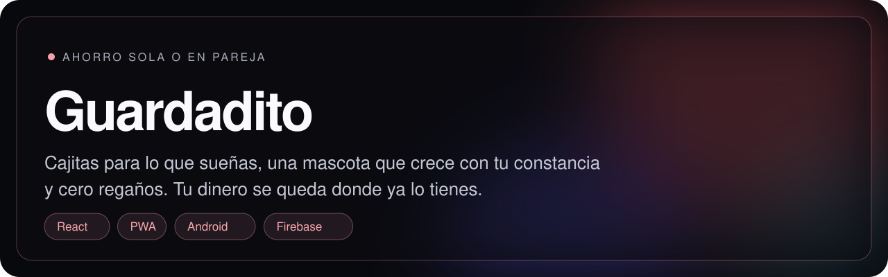
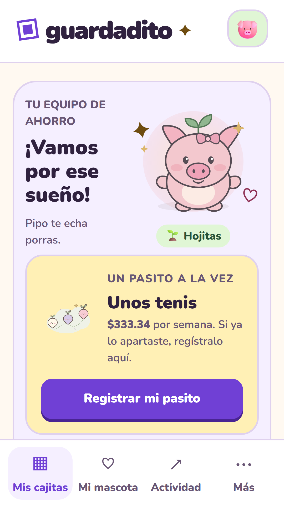
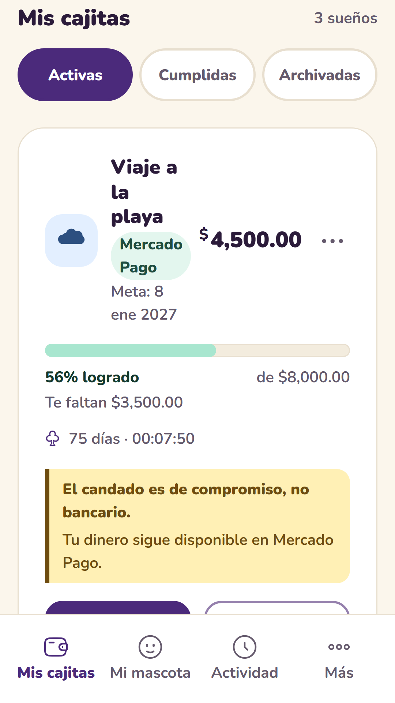
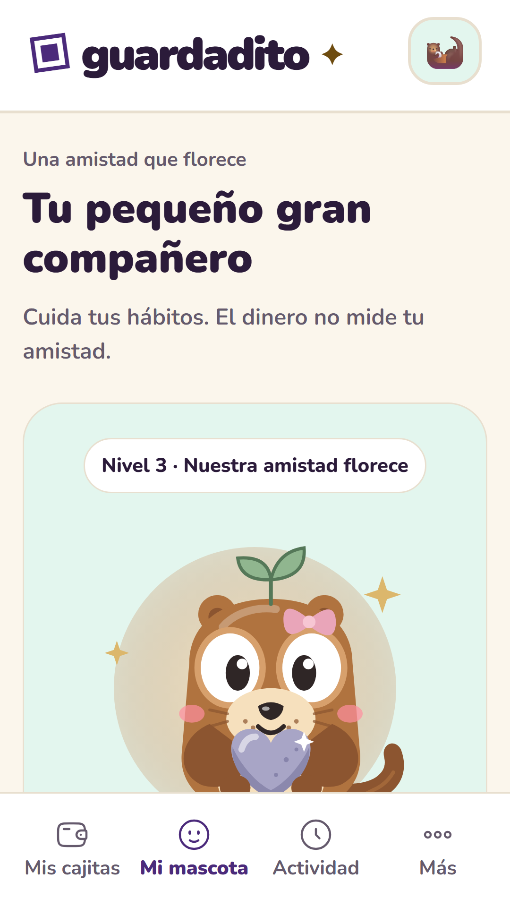
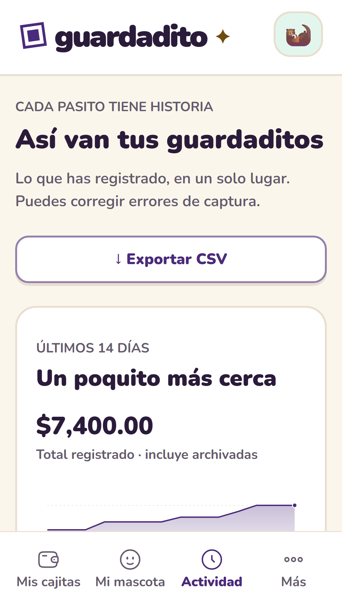
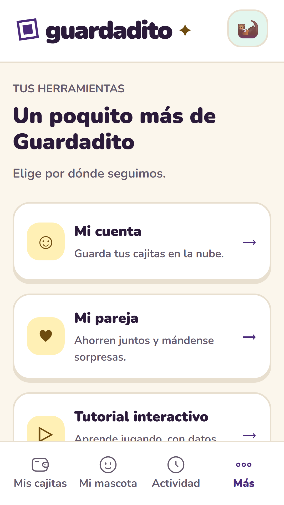

**Guardadito te acompaña a ahorrar poquito a poquito, sola o en pareja.** Creas cajitas para lo que
sueñas (un viaje, unos tenis, un colchoncito), registras cada pasito y una mascota crece con tu
constancia. Nunca te regaña.

**[Abrir la app](https://gerardobr01.github.io/CAJITAS-/)** · desde el celular, *Añadir a pantalla de
inicio* y queda instalada · [Versiones para Android](https://github.com/GERARDOBR01/CAJITAS-/releases)

<p align="center">
  
  
  
  
  
</p>

## Qué hace

- **Cajitas con plan.** Meta, monto y fecha objetivo opcional; te propone cuánto apartar por semana,
  quincena o mes. Una meta sin fecha va a tu ritmo, sin cuenta regresiva.
- **No es un banco y nunca mueve tu dinero.** Tu dinero se queda donde ya lo tienes (Nu, Mercado Pago,
  tu banco o efectivo); Guardadito lleva la cuenta de lo que apartas. Sin tasas inventadas.
- **En pareja.** Vinculan sus cuentas con un código y definen la meta y la parte de cada quien
  (mitad y mitad, 60/40…). Se mandan sorpresas (notitas, premios que se abren al 25, 50 y 100 %) y
  reciben avisos cuando el otro aparta.
- **Guardián.** Si alguien no tiene cuenta de banco, una persona de confianza puede guardar su ahorro y
  los dos ven la misma cuenta.
- **Mascota viva.** Cerdito, vaquita, conejito o Caji, que crecen con la constancia, no con cuánto
  dinero ahorras.
- **Actividad.** Gráfica de 14 días, filtros por cajita y mes, exportar a CSV, papelera de 30 días y
  respaldo en JSON.
- **Sin cuenta todo funciona**: los datos se quedan en el teléfono. Con cuenta se sincronizan entre
  dispositivos y solo tú y tu pareja vinculada ven su información. Sin anuncios.

## Cómo está hecha

| | |
|---|---|
| **App** | React + Vite, PWA instalable y con modo sin conexión |
| **Móvil** | Capacitor para Android e iPhone (paquete `mx.guardadito.ahorro`), preparada para Google Play |
| **Nube (opcional)** | Firebase Auth y Firestore, con reglas de seguridad que se prueban contra el emulador |
| **Avisos** | Web Push estándar (VAPID) desde una función serverless en Vercel; el texto lo escribe el servidor |
| **Calidad** | Pruebas unitarias con Vitest, flujos de extremo a extremo con Playwright en Chromium y reglas de Firestore con emulador, en CI |

Decisiones que me importan: dinero en **centavos enteros**, un respaldo nunca reemplaza datos sin
confirmación, un fallo de almacenamiento no pisa lo que ya había, y las integraciones con bancos son
opcionales y siempre piden revisar antes de sumar nada.

## Correrla en local

Requiere Node 24 LTS (o 22.12+) y npm.

```bash
npm ci
cp .env.example .env
npm run dev          # http://localhost:5173
npm run verify       # pruebas unitarias + build + Playwright
```

Sin credenciales funcionan las metas, los registros y los respaldos; lo que necesita configuración
externa lo dice, en vez de inventar datos.

## Más

- [Historial por versión, integraciones opcionales (Banxico, Gmail, Bitso) y publicación](docs/HISTORIAL.md)
- [Guía para publicar en Google Play](docs/play/README.md)
- [Apps nativas: Android y Xcode](docs/NATIVE-APPS.md)
- [Investigación de mercado y patrones de referencia](docs/research/)

---

<sub>Gerardo Barrera · <a href="https://github.com/GERARDOBR01">perfil</a></sub>
