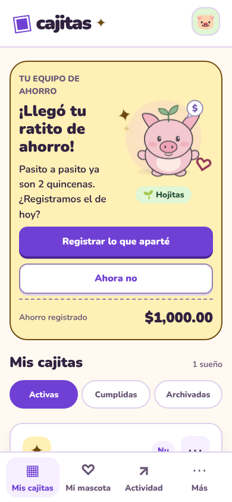
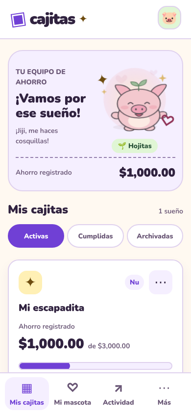
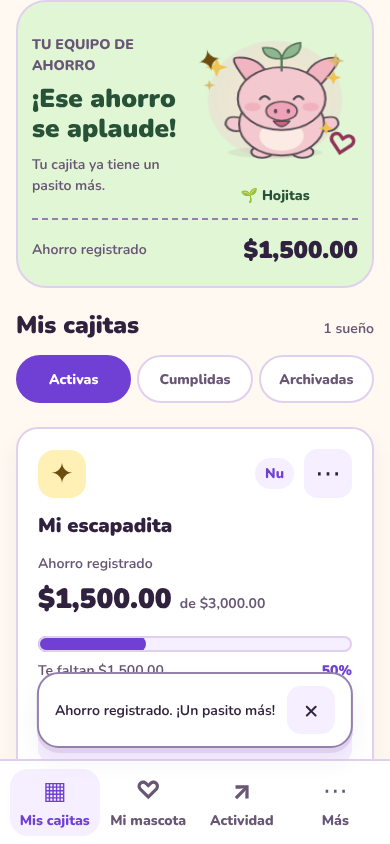
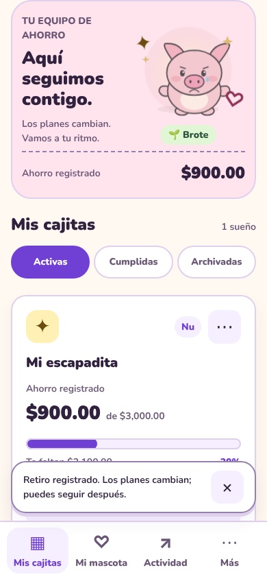
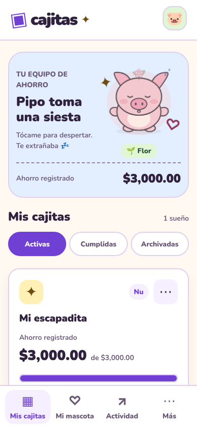
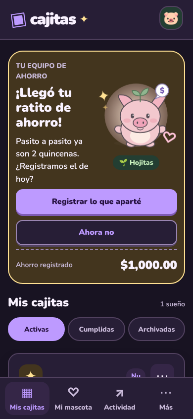

# Cajitas v0.7: mascota viva y recordatorios

## Estados de la mascota

Un solo componente (`src/components/Mascot.jsx`) dibuja las cuatro mascotas (Pipo, Mila, Luna y Caji) con los mismos estados. La prioridad vive en `petMood()` (`src/pet/state.js`): celebración > triste > emocionada > feliz > esperando > dormida > tranquila.

| Estado | Cuándo | Qué hace |
| --- | --- | --- |
| `idle` | Por defecto | Respira, parpadea, los ojos siguen el dedo |
| `happy` | Tocarla o mantenerla presionada | Ojos en arco, boca abierta, corazones |
| `excited` | Al registrar ahorro (2.6 s) | Salta con squash & stretch y destellos |
| `celebrate` | Meta cumplida | Saltos y confeti |
| `sad` | Retiro anticipado | Cejas, lagrimita; vuelve sola a `idle` en 8 s |
| `sleepy` | 7 días sin visitas ni depósitos | Ojos cerrados, “zZz”, balanceo lento |
| `waiting` | Pasó un recordatorio sin depósito después | Saluda con la mano y muestra un globito con $ |

Cinco toques en menos de 2 s hacen un giro (truco secreto). Solo se animan `transform` y `opacity`. Con “reducir movimiento” (del sistema o de Mi mascota) cambian las caras pero no hay animación; un test lo verifica.

El brote de la cabeza (accesorio “Brote”) cambia con el avance de las cajitas activas: semilla (0 %), brote, hojitas (33 %), botón (66 %) y flor (100 %).

## Recordatorios

- Frecuencias: semanal (día y hora), quincenal (15 y último día del mes) y mensual (último día). La hora debe quedar entre 08:00 y 21:59: nunca de noche. Como mucho, uno por día.
- Android programa las 6 notificaciones siguientes como avisos con fecha exacta y se reprograma cada vez que cambian tus cajitas. Cada aviso tiene las acciones “Registrar ahorro” (abre el registro de esa cajita) y “Ahora no”.
- La web no puede avisar con la pestaña cerrada: la mascota te espera al abrir Cajitas y puedes descargar un `.ics` (`RRULE:FREQ=MONTHLY;BYMONTHDAY=15,-1` para la quincena).
- Mensajes: 8 de check-in, 8 de ánimo (con la racha de periodos) y 8 de propuesta suave. La propuesta solo aparece si los últimos 3 periodos cumplieron el plan sin retiros, y sugiere como máximo +10 % del plan, redondeado hacia abajo a $10.
- Paciencia: si dos avisos seguidos se quedan sin respuesta, la frecuencia baja un nivel y se avisa una sola vez (“Te escribiré cada quincena para no molestar 💛”). “Ahora no” cuenta como respuesta y no castiga.

## Capturas

| Esperando | Feliz | Emocionada |
| --- | --- | --- |
|  |  |  |

| Triste (8 s) | Siesta con flor | Oscuro |
| --- | --- | --- |
|  |  |  |

Ajustes del recordatorio: [captura completa](../screenshots/v07/reminder-settings.png).

## Verificación

- `npm test`: 95 tests, incluidos `tests/pet.test.js` (máquina de estados, quincenas en meses de 28/29/30/31 días, horario de silencio, rotación de mensajes, tope de +10 %, paciencia y migración de respaldos v0.6).
- `npx playwright test`: 39 flujos; `e2e/v07-pet.spec.js` cubre los estados en claro y oscuro con axe.
- APK `0.7.0` (versionCode 7) compilado con `npm run build:android`.
- Pendiente: probar las notificaciones en un Android físico.
